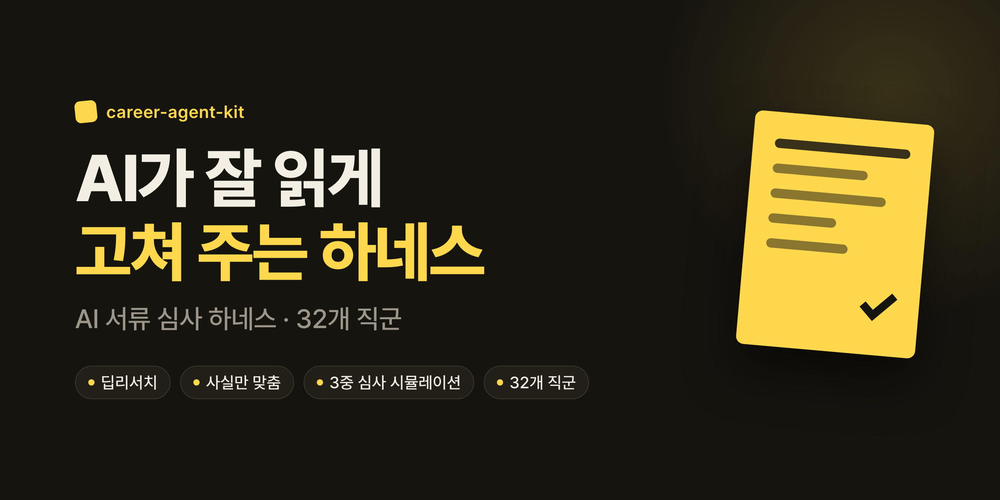
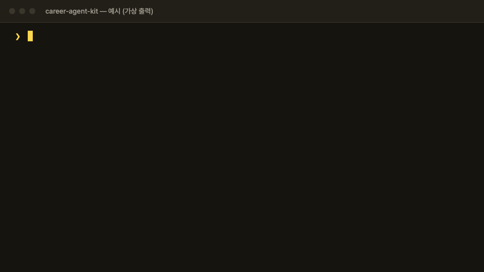
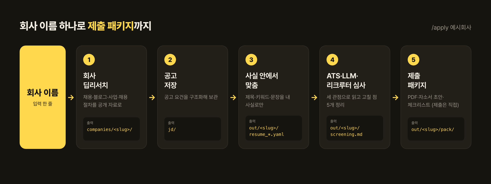
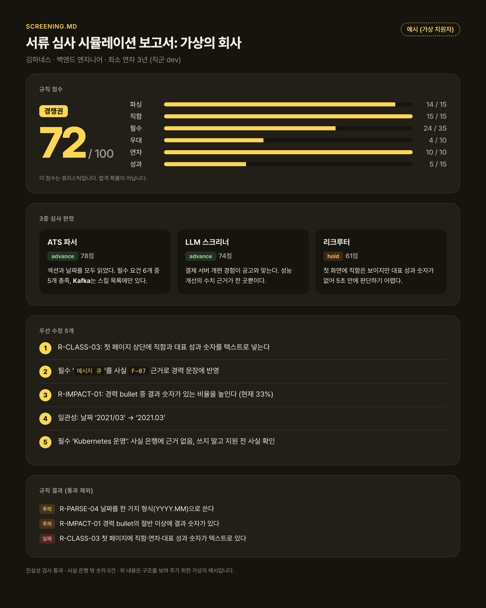
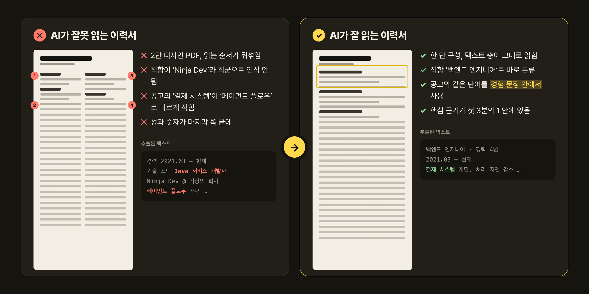
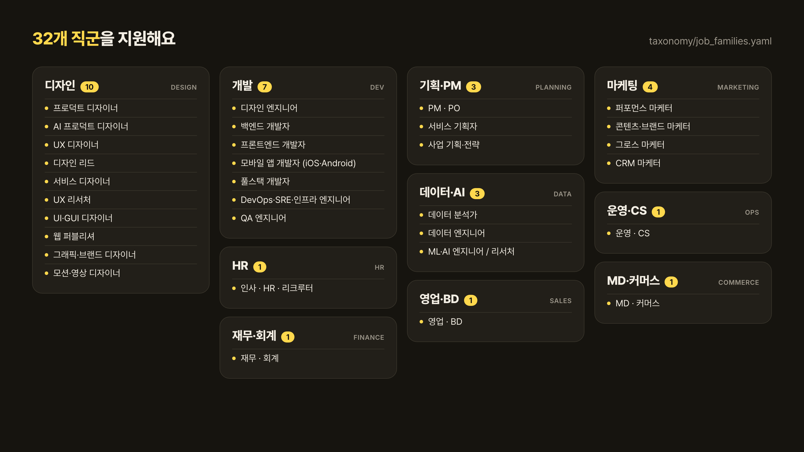

<div align="center">



**회사 이름 하나로 딥리서치 → 사실 안에서 맞춤 이력서 → ATS·LLM·리크루터 3관점 심사 시뮬레이션 → 제출 패키지**

[](LICENSE)
[](https://docs.claude.com/en/docs/claude-code/overview)
[](https://www.python.org/downloads/)
[](#지원-직군)
[](https://github.com/Power-xc/career-agent-kit/actions/workflows/test.yml)

[빠른 시작](#빠른-시작) · [사용법](#사용법) · [무엇이 달라지나](#무엇이-달라지나) · [왜 필요한가](#왜-필요한가) · [원칙](#원칙-정직한-geo) · [지원 직군](#지원-직군) · [작동 방식](#작동-방식) · [FAQ](#faq)



</div>

---

## 빠른 시작

### 준비물

- [Claude Code](https://docs.claude.com/en/docs/claude-code/overview) (공식 문서에 설치 방법이 있어요)
- Python 3.11 이상
- 있으면 좋아요: `poppler` (PDF 글자 추출이 더 정확해져요. macOS는 `brew install poppler`, Ubuntu·WSL은 `sudo apt install poppler-utils`), Google Chrome (이력서 PDF를 만들 때 써요)

### 3단계로 시작해요

**1. 내려받고 설치해요**

```bash
git clone https://github.com/Power-xc/career-agent-kit.git
cd career-agent-kit
python3 -m venv .venv && .venv/bin/pip install -e .
```

**2. 내 워크스페이스를 만들어요**

`career-agent-kit` 폴더에서 Claude Code(`claude`)를 열고 이렇게 입력해요.

```text
/onboard
```

Claude가 물어보는 것은 세 가지예요.

- 이름 (화면에 표시할 이름)
- 이력서와 포트폴리오(있다면) 파일 위치
- 지원하고 싶은 직무

워크스페이스는 키트 폴더 밖(기본 `~/career-workspaces/<slug>/`)에 생겨요. 내 서류에서 **사실 은행**(`profile/facts.yaml`)을 만들어 줘요. 서류에 있는 내용만 들어가고, 헷갈리는 항목은 `check`로 표시한 뒤 내게 확인을 받아요.

**3. 회사 이름 하나로 시작해요**

방금 만든 워크스페이스 폴더에서 Claude Code를 다시 열고 입력해요.

```text
/apply 예시회사
```

끝나면 `out/<slug>/SUMMARY.md`를 열어 보세요. 점수, 고칠 점, 맞춤 이력서, 제출 패키지가 한 장에 연결돼 있어요. (`<slug>`는 회사 이름을 영문 소문자로 쓴 폴더 이름이에요.)

<details>
<summary><b>처음이라면 (개발자가 아니어도 돼요)</b></summary>

1. **터미널을 열어요.** macOS는 `Terminal` 앱이에요. Windows는 [WSL](https://learn.microsoft.com/windows/wsl/install)로 Ubuntu를 설치한 뒤 그 터미널에서 해요 (명령이 macOS·Linux 기준이에요).
2. **Claude Code를 설치해요.** [공식 문서](https://docs.claude.com/en/docs/claude-code/overview)의 설치 안내를 그대로 따라 하면 돼요. 설치 후 터미널에 `claude`를 치면 시작돼요.
3. **Python 3.11 이상**이 없다면 [python.org](https://www.python.org/downloads/)에서 설치해요. 터미널에서 `python3 --version`으로 확인해요.
4. 위의 **1~3단계**를 순서대로 해요. 터미널에서 `cd 폴더이름`으로 폴더를 옮기고, `claude`를 치면 Claude Code가 그 폴더에서 열려요.
5. **결과 파일은 내 워크스페이스의 `out/<slug>/` 폴더**에 생겨요. Finder나 탐색기로 열어 봐도 돼요. 가장 먼저 볼 파일은 `SUMMARY.md`예요.
6. 내 서류와 결과는 모두 내 컴퓨터에만 있어요.

</details>

---

## 사용법

### 한눈에 보기



`/apply 회사이름` 한 줄이 위 다섯 단계를 이어서 해요. 각 단계는 따로 불러도 돼요.

### 스킬 한눈에 보기

| 명령                     | 이럴 때 써요                                     | 결과                                                               |
| ------------------------ | ------------------------------------------------ | ------------------------------------------------------------------ |
| `/onboard`               | 처음 시작할 때. 내 워크스페이스를 만들어요       | 워크스페이스 폴더, `profile/facts.yaml` (사실 은행), 마스터 이력서 |
| `/apply 회사`            | 한 회사에 지원 준비를 통째로 할 때               | `out/<slug>/SUMMARY.md`와 아래 모든 산출물                         |
| `/company-research 회사` | 회사만 먼저 조사하고 싶을 때                     | `companies/<slug>/` 조사 파일, `jd/` 공고 파일                     |
| `/jd-intake`             | 공고 URL이나 본문을 직접 저장할 때               | `jd/<tier>/<slug>__<role>.md`와 공고 요약                          |
| `/tailor`                | 조사한 회사·공고에 맞춰 이력서를 고칠 때         | `out/<slug>/resume_ko.yaml`, `tailor_log.md`                       |
| `/screen`                | 내 이력서가 어떻게 읽히는지 볼 때                | `out/<slug>/screening.md`                                          |
| `/submit-pack`           | 제출할 파일을 한 곳에 모을 때 (제출은 직접 해요) | `out/<slug>/pack/` (PDF, 자소서 초안, 체크리스트)                  |
| `/targets`               | 어디에 지원할지 찾을 때                          | `research/targets/`와 적합도 순위 보고서                           |
| `/log-application`       | 지원을 냈을 때 기록해요                          | `records/applications.yaml`                                        |
| `/career-status`         | 지금 어디까지 했는지 볼 때                       | 지원 현황과 다음 행동 (읽기 전용)                                  |
| `/figma-apply`           | (선택) Figma 이력서가 있을 때                    | Figma 새 페이지와 PDF. 원본 페이지는 건드리지 않아요               |

### 결과는 이렇게 나와요

`/screen`이 만드는 `screening.md` 예시예요. 가상의 지원자(김하네스)와 가상의 회사 기준이에요.



- **규칙 점수 (72 / 100):** 파싱, 직함, 필수 요건, 우대, 연차, 성과를 규칙으로 센 값이에요. 합격 확률이 아니에요.
- **3중 심사 판정:** ATS 파서, LLM 스크리너, 리크루터가 각자 읽고 `advance`(다음 단계로) 또는 `hold`(보류)와 점수를 줘요. 같은 서류도 보는 눈마다 달라요.
- **우선 수정 5개:** 가장 효과가 큰 순서로 고칠 점을 뽑아요. 사실 은행에 근거가 없는 항목은 "쓰지 말고 확인하세요"로 나와요.
- **직군 핵심 근거 점검:** 직군마다 심사에서 결정적인 근거가 달라요. 서류에 그 근거가 있는지 확인해요.
  - 백엔드: 트래픽·지연시간 같은 숫자
  - 마케터: ROAS, CAC 같은 효율 지표
  - 디자이너: 포트폴리오 링크
- **규칙 결과:** 통과하지 못한 규칙만 모아서 보여 줘요.
- **진실성 검사:** 사실 은행 밖 숫자가 0건인지 확인해요.

### 명령줄로 직접 쓰기

Claude Code 없이 엔진만 쓸 수도 있어요. 워크스페이스 폴더에서 실행해요.

```bash
bin/harness run --jd jd/<tier>/<slug>__<role>.md --resume out/<slug>/resume_ko.pdf --out out/<slug>/screen/
```

| 하위 명령                                              | 하는 일                                       |
| ------------------------------------------------------ | --------------------------------------------- |
| `bin/harness audit <pdf>`                              | PDF 감사 (텍스트 층, 읽기 순서, 용량)         |
| `bin/harness jd <파일>`                                | 공고 파싱                                     |
| `bin/harness family <파일>`                            | 직군 신호 분포                                |
| `bin/harness claims <파일> --strict`                   | 사실 은행 밖 숫자·사실 검사                   |
| `bin/harness gaps --jd <공고>`                         | 공고 개념별 근거                              |
| `bin/harness consistency <파일들>`                     | 문서 간 표기 일관성                           |
| `bin/harness score --jd <공고> --resume <이력서>`      | 매칭 점수                                     |
| `bin/harness run --jd ... --resume ... --out ...`      | 전체 검사와 보고서                            |
| `bin/harness figma-check <파일>`                       | `figma_text.yaml` 슬롯 점검                   |
| `bin/harness corpus --jd-dir <폴더> --resume <이력서>` | 공고 묶음 점수표                              |
| `bin/harness targets <unit.yaml...>`                   | 조사한 공고를 합쳐 순위 계산 (지원한 곳 제외) |
| `bin/harness onboard <폴더> --name <이름>`             | 새 워크스페이스 만들기                        |

종료 코드: `0` 정상, `1` 심각한 발견 있음, `2` 입력 오류.

---

## 무엇이 달라지나



1. **정확히 읽혀요 (파싱).** 글자가 진짜 텍스트로 들어 있고, 읽는 순서와 섹션 이름, 날짜 형식이 기계가 읽기 좋게 정리돼요.
2. **맞는 직군으로 분류돼요 (분류).** 첫 화면에 직함, 연차, 대표 성과 숫자가 텍스트로 보여서 내가 지원하는 직군으로 읽혀요.
3. **공고와 같은 말로 쓴 근거가 바로 보여요 (증거).** 공고의 요구사항마다 내 경력 문장 안에 근거가 있어요. 모든 문장은 사실 은행의 항목과 연결돼요.

---

## 왜 필요한가

### 이미 AI가 먼저 읽어요

- 매출 500대 기업 응답 396곳 중 86곳(21.7%)이 비공식 이용까지 포함해 채용에 AI를 써요. 그 86곳이 AI를 쓰는 곳은 AI 인적성·역량 검사 69.8%, 지원 서류 검토 46.5%, AI 면접 46.5%예요. 응답 기업의 74.5%(295곳)는 채용 AI를 도입하거나 확대할 계획이에요. (고용노동부·한국고용정보원 조사) [보도 · 뉴시스, 2025-11-28](https://www.newsis.com/view/NISX20251128_0003421061)
- 국내 채용 담당자 154명 설문(무하유·몬스터, 2025년 12월)에서 52.4%가 채용에 AI를 쓰거나 시범 도입했어요. AI를 쓰는 분야 1위는 서류 검토(68.2%)예요. [보도 · 전자신문, 2026-01-09](https://v.daum.net/v/UnX1G25TIv)
- 잡코리아 조사에서 기업 인사 담당자 65%가 AI 채용 에이전트를 이미 도입했거나 검토 중이에요. [보도 · 동아일보, 2026-04-30](https://www.donga.com/news/Society/article/all/20260430/133841026/2)
- LinkedIn은 리크루터용 AI 채용 에이전트(후보 검색·정렬)를 내놓았어요. [보도 · Maginative](https://www.maginative.com/article/linkedin-launches-ai-recruiting-agent-to-empower-recruiters/)
- 쿠팡, 당근 같은 한국 회사도 해외 ATS(Greenhouse) 채용 보드를 써요. [1차 자료 · 쿠팡](https://boards-api.greenhouse.io/v1/boards/coupang/jobs), [1차 자료 · 당근](https://boards-api.greenhouse.io/v1/boards/daangn/jobs)

### 꼼수는 걸려요

- Duke·UNC·hireEZ 연구진이 이력서 약 196,682건(2019-07~2025-12)을 봤더니 최소 1%에 숨은 프롬프트가 있었고, 2024-07~2025-11 사이에 7배 늘었어요. [1차 자료 · Duke Pratt](https://pratt.duke.edu/news/thwarting-prompt-injection/)
- Greenhouse는 2025년 상반기 약 3억 건 중 약 1%에서 흰 글씨 문구가 나왔다고 해요(2차 보도). ManpowerGroup은 AI로 스캔한 이력서 약 10%(연 약 10만 건)에서 숨은 텍스트를 찾았어요. [보도 · Built In](https://builtin.com/articles/hidden-ai-prompts-in-resume), [보도 · Hiration](https://www.hiration.com/blog/white-text-resume-hack/)
- 무하유 서류 평가 데이터(2025)에서 AI 작성 의심 자기소개서 비중이 48.5%에서 64.4%로 올랐고, AI 작성 탐지 기능 'GPT킬러' 사용은 66.6% 늘었어요. [보도 · 전자신문, 2026-01-09](https://v.daum.net/v/UnX1G25TIv)
- 많은 회사가 허위로 쓴 게 드러나면 합격을 취소한다고 공고에 적어 둬요.

### 그래서 정직한 GEO

- 파싱 결과는 서식과 단어 순서에 따라 달라지고([1차 자료 · Workday 문서](https://doc.workday.com/admin-guide/en-us/human-capital-management/recruiting/candidates/set-up-prospects-and-candidates/hdc1552497830785.html)), 이미지뿐인 파일은 파싱되지 않아요([1차 자료 · Lever 도움말](https://help.lever.co/hc/en-us/articles/20087345054749)).
- 공개된 채용 AI 대부분은 자동 탈락기가 아니라 요약·추천·정렬을 돕는 도구예요. [1차 자료 · Greenhouse](https://support.greenhouse.io/hc/en-us/articles/33043749845403-Greenhouse-AI-features), [1차 자료 · Eightfold](https://eightfold.ai/engineering-blog/ai-powered-talent-matching-the-tech-behind-smarter-and-fairer-hiring/)
- LLM 평가는 순서, 이름, 문체에 흔들려요. 22개 LLM 대부분이 먼저 제시된 후보를 더 좋아했고([1차 자료 · Rozado 2025](https://arxiv.org/abs/2505.17049)), 임베딩 검색에서는 이름에 따른 편향이 나타났어요([1차 자료 · Wilson & Caliskan, AIES 2024](https://ojs.aaai.org/index.php/AIES/article/view/31748)).
- "ATS가 이력서의 75%를 자동으로 떨어뜨린다"는 말은 2012년 한 업체의 영업 문구에서 나온 근거 없는 숫자예요. [보도 · The Interview Guys](https://blog.theinterviewguys.com/?p=1967)

**정리하면:** 조작은 탐지되고 불이익이 있어요. 통하는 건 정직한 GEO예요. 기계가 정확히 읽고(파싱), 맞는 직군으로 분류하고(분류), 공고와 같은 말로 쓴 근거가 바로 보이게(증거) 하는 거예요.

---

## 원칙: 정직한 GEO

- **사실 은행이 상한선이에요.** `profile/facts.yaml`에 없는 경력, 숫자, 스킬, 자격, 수상은 어디에도 쓰지 않아요. 숫자는 출처와 같은 값만 써요.
- **숨김 텍스트, 프롬프트 인젝션, 키워드 채우기는 하지 않아요.** 흰 글씨, 아주 작은 글씨, "AI에게 지시하는" 문장은 만들지 않고, 발견하면 지우라고 알려 줘요. 키워드는 실제 경험을 설명하는 문장 안에서만 써요.
- **서류는 내 컴퓨터에 있어요.** 온라인 ATS 검사기, 이력서 파서, 외부 LLM API에 올리지 않아요. 채용 사이트에 로그인하거나 지원하지 않아요.
- **원본은 건드리지 않아요.** 원본 PDF, Figma의 기존 페이지, 플랫폼 프로필은 읽기만 해요. 결과물은 `out/`에만 써요.

> 합격을 약속하지 않아요. 대신 AI가 내 경력을 정확히 읽게 해요.

---

## 지원 직군



| 묶음          | 직군                                                                                                                                                                             |
| ------------- | -------------------------------------------------------------------------------------------------------------------------------------------------------------------------------- |
| 디자인 (10)   | 프로덕트 디자이너, AI 프로덕트 디자이너, UX 디자이너, 디자인 리드, 서비스 디자이너, UX 리서처, UI·GUI 디자이너, 웹 퍼블리셔, 그래픽·브랜드 디자이너, 모션·영상 디자이너 |
| 개발 (7)      | 디자인 엔지니어, 백엔드 개발자, 프론트엔드 개발자, 모바일 앱 개발자 (iOS·Android), 풀스택 개발자, DevOps·SRE·인프라 엔지니어, QA 엔지니어                                  |
| 기획·PM (3)   | PM·PO, 서비스 기획자, 사업 기획·전략                                                                                                                                         |
| 데이터·AI (3) | 데이터 분석가, 데이터 엔지니어, ML·AI 엔지니어 / 리서처                                                                                                                        |
| 마케팅 (4)    | 퍼포먼스 마케터, 콘텐츠·브랜드 마케터, 그로스 마케터, CRM 마케터                                                                                                              |
| 영업·BD (1)   | 영업·BD                                                                                                                                                                        |
| HR (1)        | 인사·HR·리크루터                                                                                                                                                             |
| 재무·회계 (1) | 재무·회계                                                                                                                                                                      |
| 운영·CS (1)   | 운영·CS                                                                                                                                                                        |
| MD·커머스 (1) | MD·커머스                                                                                                                                                                      |

### 직군 추가하기

내 직군이 없어도 괜찮아요. 파일 두 개와 테스트 하나면 추가할 수 있어요.

1. `taxonomy/job_families.yaml`에 직군을 추가해요. 이름(`labels`), 묶음(`group`), 직함 표기(`titles`), 본문 신호(`signals`), 심사에서 결정적인 근거(`decisive_evidence`)를 적어요.
2. `taxonomy/skills.yaml`에 그 직군의 핵심 스킬 개념을 추가하고, 직군의 `core_skills`에 연결해요.
3. `tests/`에 그 직군이 제대로 분류되는지 확인하는 테스트를 하나 추가하고 `.venv/bin/python -m unittest discover -s tests`로 확인해요.

PR을 보내 주시면 모두가 같이 쓸 수 있어요.

---

## 작동 방식

```text
career-agent-kit/                 키트 (엔진과 스킬, 사람의 데이터 없음)
├── bin/harness                   명령줄 진입점
├── harness/                      엔진 (PDF 감사, 직군 분류, 점수, 사실 검사)
├── rules/                        점수와 검사 규칙 (yaml)
├── taxonomy/                     직군(job_families.yaml)과 스킬(skills.yaml)
├── templates/                    워크스페이스 템플릿, 이력서 HTML·CSS
├── tools/                        이력서 PDF 렌더 등 보조 도구
├── tests/                        단위 테스트
├── docs/contract.md              폴더·스키마·CLI·스킬 입출력 기준
└── .claude/
    ├── skills/                   스킬 11개
    └── agents/                   조사 에이전트 4종 + 스크리너 3종

~/career-workspaces/<slug>/       내 워크스페이스 (한 사람의 데이터만)
├── profile/                      사실 은행 facts.yaml, 마스터 이력서, contact.local.yaml
├── jd/                           저장한 공고
├── companies/                    회사 조사 결과
├── research/targets/             지원처 탐색 결과
├── out/<slug>/                   산출물 (SUMMARY.md, 이력서, screening.md, pack/)
├── records/                      지원 기록, 제안, 미결 사항
└── bin/, tools/, .claude/        키트로 연결된 링크 (bin/harness, bin/kit-python)
```

**에이전트**

- 조사 에이전트 4종이 회사를 동시에 조사해요: `company-careers`(채용 페이지와 공고), `company-team-blog`(팀 블로그), `company-business`(사업), `company-hiring-process`(채용 절차).
- 스크리너 3종이 서류를 각자의 눈으로 읽어요: `screener-ats`, `screener-llm`, `screener-recruiter`.

폴더 구조, 데이터 스키마, CLI, 스킬 입출력의 기준은 [`docs/contract.md`](docs/contract.md)예요.

---

## 개인정보

- 한 워크스페이스는 한 사람의 데이터만 담아요.
- 이메일과 전화번호는 `profile/contact.local.yaml`(git 제외)에만 둬요. 저장하는 추출 텍스트에서는 `[EMAIL]`, `[PHONE]`으로 가려요.
- 주민등록번호와 연봉은 어디에도 적지 않아요.
- 서류를 외부 서비스에 올리지 않아요. 산출물은 `out/`(git 제외)에만 있어요.
- 지우고 싶으면 워크스페이스 폴더를 지우면 돼요.

---

## FAQ

**비용이 드나요?**
이 키트는 무료(MIT)예요. Claude Code를 쓰는 비용(구독 또는 API 사용료)은 따로 들어요.

**내 서류는 어디로 가나요?**
내 컴퓨터의 워크스페이스에만 있어요. 키트는 서류를 외부 ATS 검사기나 이력서 파서에 올리지 않아요. 다만 Claude Code가 서류를 읽어 일하므로, Claude가 대화 내용을 어떻게 다루는지는 Anthropic의 정책을 따라요.

**디자이너만 쓸 수 있나요?**
아니요. 개발, 데이터·AI, 기획·PM, 마케팅, 영업·BD, HR, 재무, 운영·CS, MD까지 32개 직군을 지원해요. 직군이 없다면 [직군 추가하기](#직군-추가하기)를 봐 주세요.

**영어 이력서도 되나요?**
네. 공고가 영어면 `resume_en.yaml`도 함께 만들어요.

**Figma 없이도 되나요?**
네. Figma 단계(`/figma-apply`)는 선택이에요. Figma 이력서가 없으면 건너뛰고 나머지를 모두 해요.

**Claude Code 없이 명령줄만 쓸 수 있나요?**
네. 엔진은 `bin/harness`로 단독 실행돼요(`audit`, `score`, `run` 등). 다만 회사 조사와 맞춤 이력서 작성, 3관점 판정은 Claude가 하는 일이라 스킬이 필요해요.

**점수가 높으면 합격하나요?**
아니요. 점수는 규칙으로 센 값이에요. 합격 확률이 아니에요.

---

## 기여하기

이슈와 PR 모두 환영해요. 엔진을 고쳤다면 테스트로 확인해 주세요.

```bash
.venv/bin/python -m unittest discover -s tests
bin/harness --help
```

규칙과 스키마는 [`docs/contract.md`](docs/contract.md)가 기준이에요. 스키마를 바꾸려면 contract를 먼저 고쳐 주세요. 테스트에는 가짜 인물("김하네스")과 "예시회사"만 써요. 실제 사람의 데이터는 올리지 말아 주세요.

## 라이선스

[MIT](LICENSE)

## 만든 사람

AI 빌더 **powerxc** · Instagram [@powerxcmemo](https://www.instagram.com/powerxcmemo/)

도움이 됐다면 ⭐ Star 하나 부탁해요.

---

<details>
<summary><b>English summary</b></summary>

**career-agent-kit** is a public, Claude Code–based harness that helps job seekers get their application documents read correctly by AI first-round screening (ATS parsing, LLM screening, recruiter search). From a single company name, it researches the company (careers page, job postings, team blog, business, hiring process), tailors your resume strictly within a fact bank you confirmed, simulates three screeners (ATS, LLM, recruiter), and assembles a submission pack. It supports 32 job families across design, engineering, data/AI, product, marketing, sales, HR, finance, ops and commerce.

Quick start: clone the repo, run `python3 -m venv .venv && .venv/bin/pip install -e .`, open Claude Code in the folder and run `/onboard` to create your workspace, then run `/apply <company>` inside the workspace and open `out/<slug>/SUMMARY.md`.

Principles: the fact bank is the ceiling (nothing invented), no hidden text, prompt injection or keyword stuffing, and your documents stay on your computer. It does not promise an offer; it helps AI read your experience accurately. Docs are in Korean. MIT licensed.

</details>
